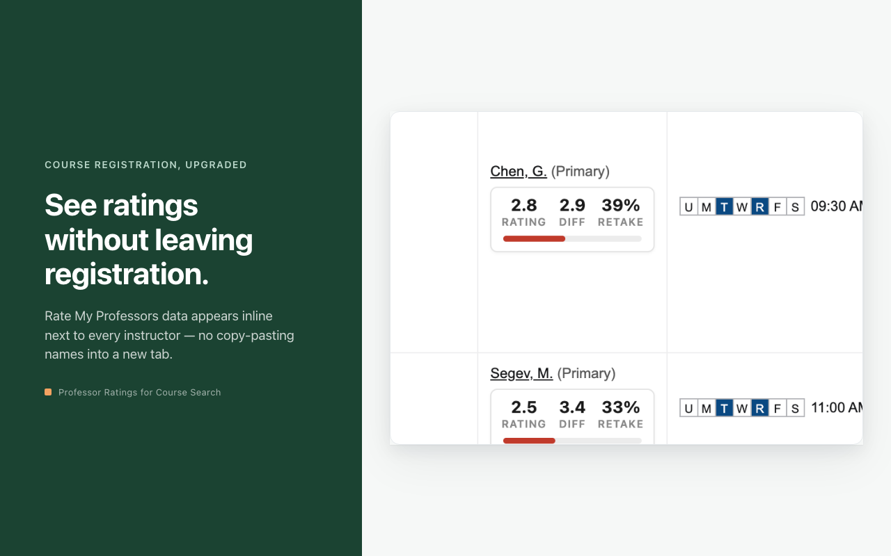
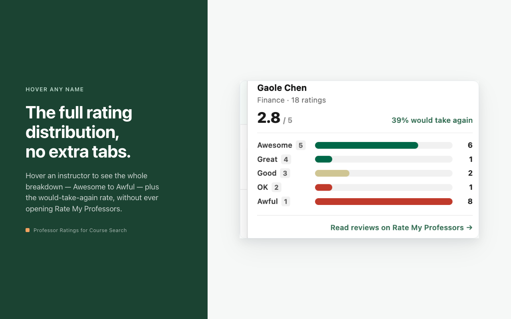
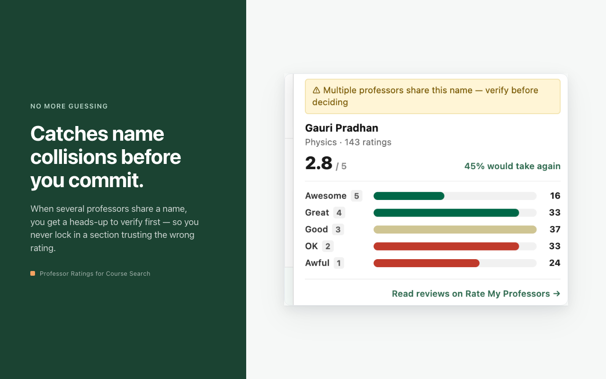

# Professor Ratings for Course Search

**Rate My Professors ratings, inline on your university's class search.** No new tab, no copy-pasting names, no guessing which "Mitchell, K." you are about to sign up for.

[](https://chromewebstore.google.com/detail/professor-ratings-for-cou/fddicmacgfogicmodgojnmgenlepeejb)
[](https://github.com/Konald58/rmp-extension/actions/workflows/test.yml)




## What it does

- Finds every instructor name on the class-search page and looks it up on Rate My Professors for your school.
- Renders a compact card under the name: **Rating, Difficulty, Retake %**, with a tier bar (green 4.0 and up, gold 3.0 to 3.9, red below 3.0).
- Hover for the full rating distribution, Awesome to Awful, plus would-take-again.
- Click to open the professor's RMP profile.
- Warns when two professors share a name and the match is uncertain, instead of quietly picking one.
- Stores exactly one thing: your chosen school. No accounts, no analytics, no tracking. See [PRIVACY.md](PRIVACY.md).

| Hover: full distribution | Name collisions are flagged |
|---|---|
|  |  |

## Where it works

The extension is built per registration system, not per school. Every school on a supported system should work, but only the schools below have been checked against real pages. If yours is not listed, try it and [report what you see](https://github.com/Konald58/rmp-extension/issues/new?template=unsupported_school.md).

| Registration system | Pages | Verified at | How verified |
|---|---|---|---|
| **Ellucian Banner 9** (Student Self-Service "Registration") | Find Classes results, Schedule Details | University of South Florida | Live smoke test, logged in, 2026-05 |
| **Ellucian Banner 8** (classic self-service) | Class Schedule Listing, Detailed Class Information, Look Up Classes | University of Oregon (DuckWeb) | Real schedule-listing capture, 2026-10 |
| **Oracle PeopleSoft Campus Solutions** | Class Search (public guest namespace) | Northern Arizona University | Real class-search capture, 2026-05 |
| **University of Oregon DuckWeb schedule** (custom Banner 8 front end) | Class Schedule search results | University of Oregon | Real capture plus in-browser run, 2026-10 |

Not supported yet: Workday Student (Cornell, USC, Yale, CMU and others). It needs a real class-search page capture from a Workday school. If you can provide one, open an issue.

## Install

**Chrome Web Store:** [Professor Ratings for Course Search](https://chromewebstore.google.com/detail/professor-ratings-for-cou/fddicmacgfogicmodgojnmgenlepeejb)

**From source:**

1. Clone this repo.
2. Open `chrome://extensions`, turn on Developer mode, click Load unpacked, pick the repo folder.
3. Click the extension icon, search for your school, pick it.
4. Open your university's class search.

Until you pick a school, every instructor shows "Choose school in popup" and nothing is looked up.

## How it works

```
content/
├── common.js              shared: RMP lookups (via the worker), badge + popover, adapter registry
├── name-parser.js         Banner 9 "Lastname, F. (Primary)" parser
├── adapters/
│   ├── banner.js          Banner 9: text-node walk for "(Primary)"/"(Secondary)"
│   ├── banner8.js         Banner 8: Instructors column, "First Last (P)", course from the title row
│   ├── peoplesoft.js      PeopleSoft: span[id^="MTG_INSTR$"], "First Last"
│   └── duckweb.js         UO DuckWeb: Instructor column, "Last F", course tracked per header row
└── index.js               dispatcher: first adapter whose matches(location) is true runs

background.js              service worker: RMP GraphQL client, 6 requests in flight max
lib/scoring.js             candidate scoring: first name, then subject/department, then rating count
popup.{html,js}            school picker (typeahead over RMP's directory) + report-an-issue links
styles.css                 cards, popover, dark mode
```

**Adapters.** Each registration system is one file that registers itself, detects its page by URL, finds instructor cells its own way, and hands each `{element, parsed name, course}` to the shared pipeline. Adding a system means adding one file and one manifest pattern.

**Matching is strict.** The last name must match exactly and the first initial must match; a full first name (PeopleSoft and Banner 8 provide one) beats everything else, then the course subject is checked against the professor's department, then rating count breaks ties. If two candidates still tie, the card is flagged ambiguous. Showing nothing beats showing the wrong person.

**All network calls go through the service worker.** Content scripts cannot reliably bypass CORS in Manifest V3; the worker can. Concurrency is capped so a 60-row results page does not fire 60 parallel requests at RMP.

**Orphaned pages are handled.** When the extension updates while a registration page is open, that page's content script loses `chrome.runtime`. Every IPC call is guarded and observers disconnect, so the page keeps working instead of throwing.

## Development

```bash
npm install
npm test        # Jest + jsdom: 95 tests
npm run lint    # ESLint
```

Tests run parsers and full adapter pipelines against real captures in `tests/fixtures/` (NAU PeopleSoft, UO Banner 8, UO DuckWeb) with a stubbed worker. CI runs lint and tests on every push.

There is no build step. The store package is the repo's runtime files zipped (`lib/scoring.js` must be included: the worker pulls it in via `importScripts`, so the manifest never lists it).

## Companion: MCP server

[rmp-mcp](https://github.com/Konald58/rmp-mcp) exposes the same Rate My Professors data to any MCP client (Claude, Cursor, VS Code, ChatGPT and others) with the same strict matching rules. The extension is for the moment of registration; the server is for the research before it.

## Disclaimer

Independent open-source project. Not affiliated with, endorsed by, or sponsored by any university or by Rate My Professors. Ratings are community-submitted and may be inaccurate, outdated, or unrepresentative. Use them as one input, not a verdict.

## License

[MIT](LICENSE)
